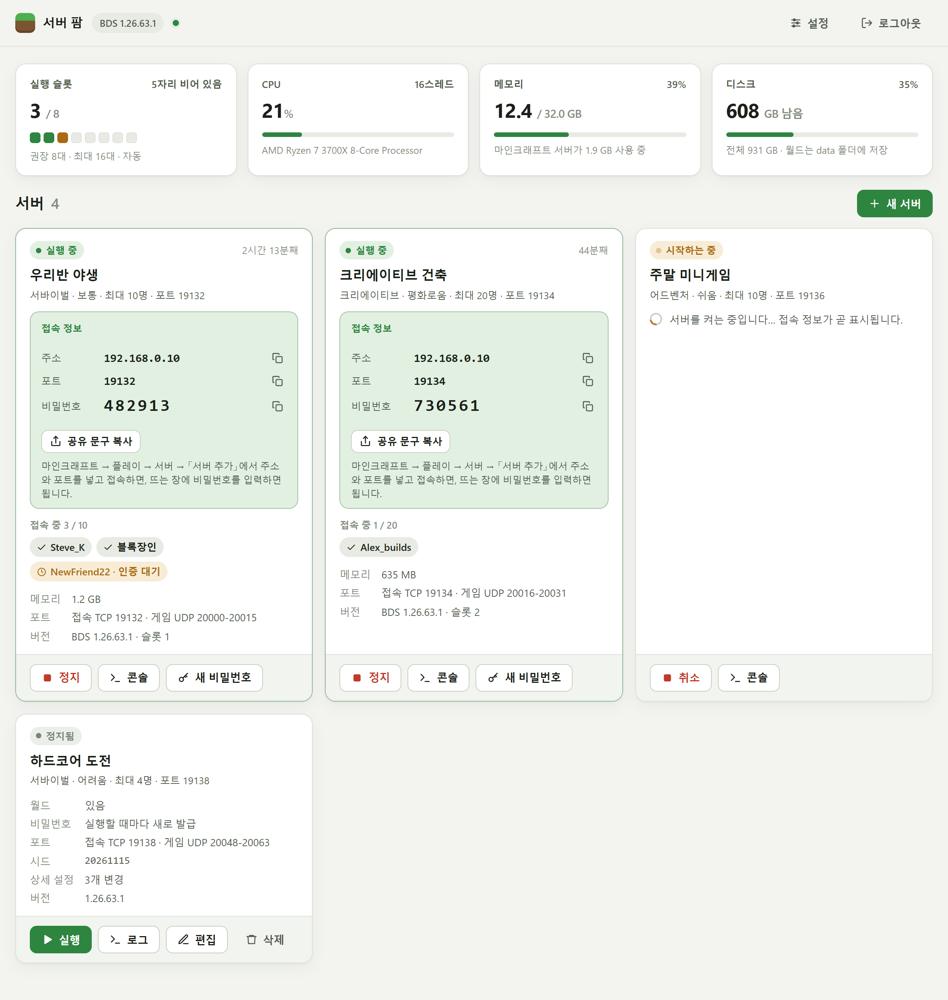
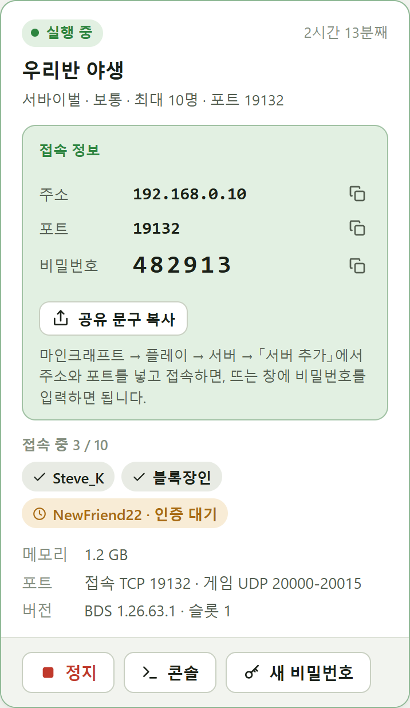
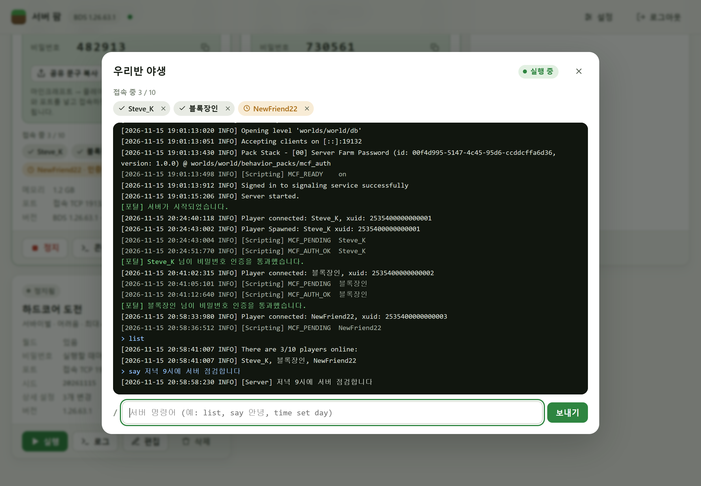
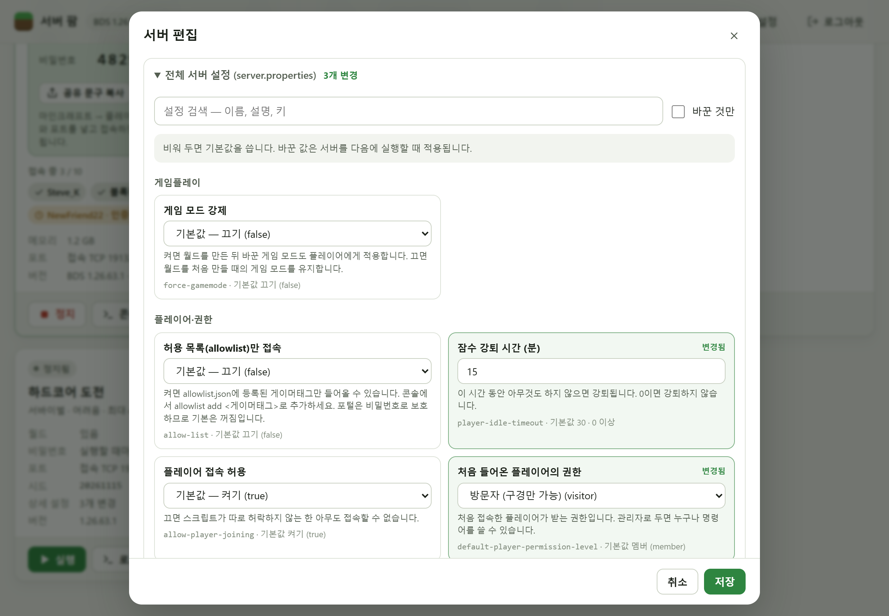
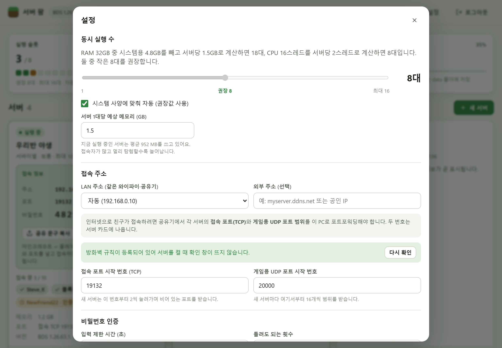

# 마인크래프트 서버 팜

한 PC에서 **마인크래프트 서버 여러 개**를 웹 화면으로 켜고 끄는 포털입니다. 서버마다 **Bedrock(베드락)** 과 **Java(자바)** 중 하나를 고릅니다.

- **Bedrock**: 휴대폰·태블릿·Windows 앱·콘솔 마인크래프트용. Mojang의 Bedrock Dedicated Server(BDS)로 실행합니다.
- **Java**: PC 런처로 하는 Java Edition용. **서버마다 게임 버전(1.18.2 ~ 최신)** 을 고르고, Mojang 공식 서버 프로그램과 그 버전에 맞는 Java 실행 환경을 포털이 알아서 받아 실행합니다 (PC에 Java를 설치할 필요 없음). 자세한 내용은 [Java 서버](#java-서버)를 보세요.
- 서버 목록을 만들어 두고, **빈 슬롯이 있으면** 원하는 서버를 실행합니다.
- 동시에 몇 대까지 돌릴지는 **PC 사양(CPU 스레드·RAM)을 보고 계산한 권장값**을 바탕으로 직접 고릅니다.
- 서버를 실행하면 **접속 주소·포트·비밀번호**가 자동으로 만들어져 화면에 표시되고, 친구에게 보낼 안내 문구도 복사할 수 있습니다.
- 접속한 플레이어는 게임 안에 뜨는 창에 **비밀번호를 입력해야** 플레이할 수 있습니다.



<sub>스크린샷의 서버·플레이어 이름과 주소는 예시입니다.</sub>

## 실행하기

필요한 것: Windows 10/11, [Node.js](https://nodejs.org) 18.17 이상. Linux(Ubuntu)는 [아래](#linux에서-실행하기-ubuntu)를 보세요. macOS용 서버 프로그램은 Mojang이 만들지 않아 지원하지 않습니다.

```bash
npm install
npm start
```

Windows에서는 `start.bat`을 더블클릭해도 됩니다. 브라우저에서 `http://localhost:8080`을 열면 됩니다. 같은 공유기에 연결된 휴대폰·다른 PC에서는 콘솔에 표시되는 `http://192.168.x.x:8080` 주소로 접속합니다.

처음 접속하면:

1. **관리자 비밀번호**를 정합니다 (8자 이상). 서버를 켜고 끄는 포털 자체의 비밀번호입니다.
2. **`firewall-setup.bat`을 한 번 실행**합니다 (관리자 권한 확인 창에서 「예」). 이걸 해 두지 않으면 서버를 켤 때 Windows 방화벽 확인 창이 떠서, 아무도 없는 서버 PC에서는 다른 기기가 접속하지 못합니다. 아래 [Windows 방화벽](#windows-방화벽) 참고.
3. **새 서버**에서 에디션(Bedrock / Java)을 고르고 월드를 만든 뒤 **실행**을 누릅니다.
   - Bedrock: 서버 프로그램(BDS)이 없다면 화면 위 안내에서 **Minecraft EULA·개인정보처리방침에 동의**하고 내려받습니다. Mojang 공식 사이트에서 최신 버전(약 85MB)을 받아 `data/bedrock/<버전>/`에 풉니다.
   - Java: 서버를 만들 때 **Minecraft EULA에 동의**하면, 처음 실행할 때 고른 버전의 서버 프로그램과 Java 실행 환경을 자동으로 받습니다 (약 150MB, 버전마다 한 번).

## 플레이어가 접속하는 방법

### Bedrock 서버

1. 마인크래프트 → **플레이 → 서버 → 서버 추가**
2. 포털에 표시된 **주소**와 **포트**를 입력하고 접속
3. 접속하면 뜨는 **「서버 비밀번호」 창**에 비밀번호 입력

비밀번호를 입력하기 전에는 화면이 어둡고 움직일 수 없으며, 블록을 부수거나 아이템을 쓸 수 없습니다. 제한 시간(기본 120초) 안에 입력하지 않거나 5번 틀리면 강퇴됩니다. 둘 다 **설정 → 비밀번호 인증**에서 바꿀 수 있습니다.

비밀번호는 서버를 실행할 때마다 새로 만들어지고, 실행 중에도 **새 비밀번호** 버튼으로 바꿀 수 있습니다 (이미 인증하고 플레이 중인 사람은 영향 없음). 서버별로 **비밀번호 보호**를 끌 수도 있습니다.

포털은 휴대폰에서도 열 수 있습니다. **공유 문구 복사**를 누르면 주소·포트·비밀번호와 접속 방법이 한 번에 복사되어 메신저로 바로 보낼 수 있습니다. 접속자 목록에는 비밀번호를 입력한 사람(✓)과 아직 입력하지 않은 사람(인증 대기)이 구분되어 보입니다.



> 플레이어의 마인크래프트 버전과 서버(BDS) 버전이 같아야 접속됩니다. 게임이 업데이트되면 포털 위쪽에 업데이트 안내가 뜨니, 설정에서 새 버전을 내려받은 뒤 서버를 다시 실행하세요. 월드는 그대로 유지됩니다.

### Java 서버

1. 마인크래프트 런처에서 **서버와 같은 버전**(카드에 표시)을 골라 실행 → **멀티플레이 → 서버 추가**
2. 포털에 표시된 **서버 주소**(`192.168.x.x:25565`처럼 주소와 포트가 한 줄)를 입력하고 접속
3. 접속하면 화면이 어둡고 움직일 수 없습니다. 채팅창(**T**)을 열고 **`/trigger pin set 비밀번호`** 를 입력합니다. 채팅에 뜨는 「여기를 눌러」를 누르면 `/trigger pin set `까지 채워지니 숫자만 치면 됩니다.

제한 시간·틀려도 되는 횟수는 Bedrock과 같은 설정(**설정 → 비밀번호 인증**)을 씁니다. 나갔다가 다시 들어오면 비밀번호를 다시 입력해야 합니다.

## 콘솔

서버 카드의 **콘솔**에서 서버 로그를 실시간으로 보고, 명령어(`list`, `say 안녕`, `time set day` 등)를 보내고, 접속자를 내보낼 수 있습니다. 누가 비밀번호 인증을 통과했는지도 여기에 남습니다.



## Java 서버

- **버전**: 서버마다 Java Edition 1.18.2 ~ 최신 릴리스 중 하나를 고릅니다 (목록은 Mojang에서 받아 옴). 플레이어는 런처에서 같은 버전을 골라야 접속할 수 있습니다.
- **내려받기**: 고른 버전을 처음 실행할 때 Mojang 공식 서버에서 서버 프로그램(`server.jar`)과, 그 버전이 요구하는 Java 실행 환경(26.x는 Java 25, 1.20.5~1.21.x는 Java 21, 그 이전은 Java 17)을 받아 `data/java`에 둡니다. 같은 버전·같은 Java를 쓰는 서버끼리는 한 벌을 같이 씁니다. **설정 → Java 서버 프로그램**에서 미리 받을 수도 있습니다.
- **EULA**: Java 서버는 Minecraft EULA에 동의해야 실행됩니다. 서버를 만들 때(또는 설정에서) 한 번 동의하면, 포털이 서버마다 `eula.txt`를 써 줍니다. Bedrock 서버 프로그램을 받을 때 이미 동의했다면 다시 묻지 않습니다.
- **버전 올리기**: 편집에서 더 높은 버전을 고르면 다음 실행 때 월드가 그 버전으로 바뀝니다. **한 번 올린 월드는 낮은 버전으로 되돌릴 수 없으니**(포털이 막음) 먼저 백업하세요.
- **메모리**: 서버마다 최대 메모리(기본 2GB)를 정합니다. Java 서버는 Bedrock보다 메모리를 많이 쓰니, 여러 대를 돌린다면 「서버 1대당 예상 메모리」도 함께 올리세요.
- **비밀번호 보호**는 **1.21 이상**에서만 됩니다 (1.21에서 생긴 기능으로 플레이어를 잠그기 때문). 그보다 낮은 버전은 비밀번호 없이 실행되므로, 콘솔에서 `whitelist on`, `whitelist add <이름>`으로 화이트리스트를 쓰세요.
- **정품 계정 인증**(online-mode)은 기본으로 켜져 있습니다. 끄면 아무 이름으로나 접속할 수 있습니다.
- 서버를 만든 뒤에는 에디션을 바꿀 수 없습니다 (월드 형식이 다름).

### Java 비밀번호가 동작하는 방식

Java Edition에는 Bedrock 같은 스크립트가 없어서 둘로 나눠 처리합니다.

- 포털이 실행할 때마다 월드에 **데이터 팩**(`world/datapacks/mcf_auth`)을 넣습니다. 비밀번호를 입력하지 않은 플레이어는 화면이 어둡고, 걷거나 뛸 수 없고, 블록·몹에 손이 닿지 않습니다. 포털이 꺼져 있어도 잠금은 유지됩니다.
- 플레이어가 `/trigger pin set …`을 입력하면 서버 콘솔에 기록되고(`log_admin_commands` 게임 규칙, 기본 켜짐), 포털이 이를 읽어 비밀번호를 비교합니다. 맞으면 잠금을 풀고, 틀리거나 시간이 지나면 포털이 강퇴합니다. 그래서 **포털이 꺼진 상태(「연결 끊김」)에서는 새로 들어온 사람이 인증할 수 없습니다** — 강제 종료 후 다시 실행하세요.
- OP는 채팅에서 다른 사람이 입력한 `/trigger` 값을 볼 수 있습니다 (마인크래프트가 OP에게 명령 사용을 알려 주기 때문).
- 포털은 비밀번호 확인을 위해 콘솔 명령을 자주 보내므로, OP 채팅에 그 결과가 뜨지 않게 `broadcast-console-to-ops`를 기본으로 끕니다.

## 서버 설정

서버 카드의 **편집**에서 바꿉니다 (서버가 정지되어 있을 때). 바꾼 설정은 다음에 실행할 때 적용됩니다.

- **기본 설정**: 이름, 게임 모드, 난이도, 최대 인원, 포트, 시드, 비밀번호 보호
- **고급 설정**: Xbox 계정 인증, 치트, LAN 표시, 시야 거리, 게임용 UDP 시작 포트
- **전체 서버 설정 (server.properties)**: BDS의 나머지 설정 전부. 설치된 BDS 버전의 `server.properties`에서 목록을 읽어 오므로, BDS를 업데이트해 새 설정이 생기면 자동으로 나타납니다 (한국어 설명이 없는 새 설정은 Mojang의 영어 설명이 표시됨).
  - 비워 두면 기본값을 쓰고, 바꾼 값만 저장됩니다. 검색과 「바꾼 것만」 보기로 찾을 수 있습니다.
  - 값은 저장할 때 검사합니다 (예: 시뮬레이션 거리는 4~12). 잘못된 값은 해당 칸으로 이동해 알려 줍니다.
  - 포트, UDP 범위, 연결 방식(transport), 월드 폴더 이름, 콘솔 로그 설정은 포털이 관리하므로 바꿀 수 없습니다.
  - 허용 목록(allow-list)은 포털 기본값이 **꺼짐**입니다 (비밀번호로 보호). 켜면 콘솔에서 `allowlist add <게이머태그>`로 등록한 사람만 접속할 수 있습니다.
  - **Java 서버**는 설정 파일에 설명이 없어서, 고른 버전의 서버 프로그램이 만든 기본 설정에서 목록을 읽고 주요 설정에만 한국어 이름·설명을 붙입니다. 그래서 버전을 내려받은 뒤에 이 목록이 보입니다. 포털이 관리하는 것은 접속 포트(`server-port`, `query.port`)와 월드 폴더 이름입니다. 화이트리스트(`white-list`)는 26.x부터 기본이 켜짐이지만 포털 기본값은 **꺼짐**입니다.



## 동시 실행 수

설정에서 고르며, 포털이 다음과 같이 권장값을 계산합니다.

- 메모리 기준: (전체 RAM − 시스템용 여유분 15%) ÷ 서버 1대당 예상 메모리(기본 1.5GB)
- CPU 기준: CPU 스레드 수 ÷ 2
- **권장값 = 둘 중 작은 값**, 고를 수 있는 최대값 = 메모리 기준과 스레드 수 중 작은 값

예: RAM 32GB · 16스레드 → 메모리 기준 18대, CPU 기준 8대 → **권장 8대**. 빈 서버는 400MB 안팎으로 시작하지만 접속자가 많고 멀리 탐험할수록 1~2GB까지 늘어나므로, 실제 사용량(설정 화면에 표시)을 보고 「서버 1대당 예상 메모리」를 조정하세요.



## 포트

Bedrock 서버는 포트를 두 가지, Java 서버는 한 가지 씁니다. 모두 서버 카드에 표시됩니다.

| 에디션 | 용도 | 프로토콜 | 기본값 | 플레이어가 입력? |
| --- | --- | --- | --- | --- |
| Bedrock | 접속 (연결 맺기) | TCP | 19132, 19134, 19136 … | 예 — 「서버 추가」의 포트 |
| Bedrock | 게임 데이터 | UDP 범위 16개 | 20000-20015, 20016-20031 … | 아니요 |
| Java | 접속·게임 | TCP | 25565, 25566, 25567 … | 예 — 서버 주소의 `:` 뒤 |

BDS 기본 설정은 UDP를 접속 포트 하나로 같이 쓰지만, 인터넷 접속에서 그 방식이 `Terracotta` 오류로 실패한다는 보고가 많아(아래 참고) 서버마다 UDP 범위를 따로 줍니다. 같은 와이파이에서 휴대폰으로 이 범위를 써서 접속되는 것을 확인했습니다. 시작 번호는 **설정 → 접속 주소**에서 바꿀 수 있습니다.

## 인터넷(다른 집)에서 접속하려면

1. 공유기 설정에서 포트포워딩합니다. Bedrock 서버는 **접속 포트(TCP)** 와 **게임 UDP 범위**, Java 서버는 **접속 포트(TCP)** 하나를 이 PC로 넘기면 됩니다.
2. **설정 → 접속 주소 → 외부 주소**에 공인 IP나 DDNS 도메인을 넣으면 카드와 공유 문구에 함께 표시됩니다.

## Windows 방화벽

Windows 방화벽은 프로그램을 **실행 파일 경로**로 기억합니다. 포털은 Bedrock 서버를 항상 `data\slots\1` ~ `32` 폴더에서 실행하고(어느 서버든 비어 있는 슬롯에서 실행), Java 서버는 `data\java\runtime\<이름>\bin\java.exe`로 실행하므로, 이 경로들에 대한 허용 규칙을 한 번만 만들어 두면 서버를 켤 때 확인 창이 더는 뜨지 않습니다.

프로젝트 폴더의 **`firewall-setup.bat`** 을 더블클릭하고 관리자 권한 확인 창에서 「예」를 누르면 됩니다. 스크립트가 하는 일:

- `data\slots\1~32\bedrock_server.exe`에 대해 들어오는 연결 허용 규칙 생성 (개인·도메인 네트워크)
- Java 서버용 `java.exe` 허용 규칙 생성 — 지금 Minecraft가 쓰는 Java 실행 환경 4가지(Java 17·21·25)는 아직 받지 않았어도 미리 만듭니다. Mojang이 새 Java를 쓰기 시작하면 포털에 안내가 뜨니 그때 다시 실행하세요.
- 웹 포털(`node.exe`, TCP 8080) 허용 규칙 생성
- 이 `data` 폴더 아래 프로그램에 대해 예전에 확인 창으로 만들어진 규칙 정리 (확인 창에서 「취소」를 누르면 **차단** 규칙이 생기는데, 차단 규칙이 허용보다 우선하기 때문)

규칙은 모두 「Minecraft Server Farm」 그룹으로 만들어집니다. 옵션: 공용 네트워크도 허용하려면 `firewall-setup.bat -IncludePublic`, 규칙을 지우려면 `firewall-setup.bat -Remove`. 프로젝트 폴더를 옮기면 경로가 바뀌니 다시 실행하세요. 포털 화면에 규칙 상태가 표시되고, 규칙이 없으면 안내가 뜹니다.

## Linux에서 실행하기 (Ubuntu)

필요한 것: Mojang이 지원하는 Ubuntu 22.04 이상(x86_64), Node.js 18.17 이상.

WSL2의 Ubuntu에서 다음을 확인했습니다: 포털에서 Linux용 서버 프로그램 설치, 서버 두 대 동시 실행(슬롯 폴더), 게임 내 비밀번호 확인(정답·5회 오류·시간 초과), 다른 슬롯에서 다시 실행해도 같은 월드 유지, Ctrl+C와 systemd 정지 때 월드 저장 후 정상 종료. 실제 Linux 서버 PC와 휴대폰으로 접속해 보는 것은 아직 하지 않았습니다.

```bash
sh start.sh
```

포털 화면에서 서버 프로그램을 설치하면 Linux용 BDS를 받습니다. 나머지 사용법은 Windows와 같습니다.

- **방화벽**: Linux에는 프로그램마다 뜨는 확인 창이 없어서 `firewall-setup.bat`이 필요 없습니다. 대신 포트를 한 번 열어 두세요 (ufw 예시, 서버를 많이 만들었다면 범위를 늘리세요):
  ```bash
  sudo ufw allow 8080/tcp
  sudo ufw allow 19132:19195/tcp
  sudo ufw allow 20000:20511/udp
  sudo ufw allow 25565:25596/tcp
  ```
- Java 서버도 Linux용 Java 실행 환경을 Mojang에서 받아 씁니다 (x86_64). Linux에서 Java 서버는 아직 실행해 보지 않았습니다.
- **부팅할 때 자동 실행 (systemd)**: `linux/minecraft-server-farm.service`의 `User`, `WorkingDirectory`, `ExecStart`(node 경로)를 환경에 맞게 고친 뒤:
  ```bash
  sudo cp linux/minecraft-server-farm.service /etc/systemd/system/
  ```
  ```bash
  sudo systemctl daemon-reload
  ```
  ```bash
  sudo systemctl enable --now minecraft-server-farm
  ```
  서비스를 끄면(`systemctl stop`) 포털이 각 서버의 월드를 저장하고 정지한 뒤 종료합니다. 이를 위해 서비스 파일에 `KillMode=mixed`가 들어 있으니 지우지 마세요. 없으면 systemd가 마인크래프트 서버에도 직접 SIGTERM을 보내는데, BDS는 이때 월드를 저장하지 않고 바로 꺼집니다. 포털 로그(`journalctl -u minecraft-server-farm`)에 서버마다 「서버가 정지되었습니다」가 나오면 정상 저장된 것이고, 「저장을 마치기 전에 외부에서 종료」가 나오면 저장되지 않은 것입니다.
- 서버가 바로 꺼지고 콘솔에 `error while loading shared libraries`가 보이면, 메시지에 나온 라이브러리를 설치하세요 (예: `sudo apt install libcurl4`).
- WSL2에서 돌린다면, 기본 네트워크 방식(NAT)으로는 같은 와이파이의 휴대폰이 접속할 수 없습니다. `%UserProfile%\.wslconfig`에 `networkingMode=mirrored`를 설정하세요.

## 포털 끄기

- 포털 창에서 **Ctrl+C** → 실행 중인 서버를 정상적으로 저장·정지한 뒤 종료합니다.
- 포털이 강제로 꺼지면 서버는 백그라운드에서 계속 돌아갑니다. 포털을 다시 켜면 그 서버는 **「연결 끊김」**으로 표시되고(슬롯을 차지함), **강제 종료** 후 다시 실행하면 정상적으로 관리됩니다.

## 폴더 구조

```
start.bat / start.sh               포털 실행 (Windows / Linux)
firewall-setup.bat / .ps1          Windows 방화벽 규칙 등록 (한 번)
linux/minecraft-server-farm.service  Linux systemd 서비스 예시
docs/screenshots/                  README용 화면 캡처
server/            포털 백엔드 (Node.js + Express)
  authpack/main.js 비밀번호 창을 띄우는 Bedrock 게임 내 스크립트 (서버를 실행할 때 월드에 설치됨)
  java.js          Java 서버 프로그램·Java 실행 환경 설치
  javaauth.js      Java 비밀번호용 데이터 팩 (서버를 실행할 때 월드에 설치됨)
public/            웹 화면
data/              실행 중 생기는 데이터 (git에서 제외)
  config.json      포털 설정
  servers.json     서버 목록
  bedrock/<버전>/   내려받은 BDS
  java/versions/<버전>/  내려받은 Java 서버 프로그램 (server.jar와 라이브러리, 기본 설정)
  java/runtime/<이름>/   내려받은 Java 실행 환경 (Mojang 제공)
  instances/<id>/  서버별 데이터 (Bedrock 월드: worlds/world, 서버 식별 키: keys/ · Java 월드: world/)
  slots/<번호>/     Bedrock 서버가 실제로 실행되는 폴더 (실행할 때 그 서버의 데이터에 연결됨)
  trash/           삭제한 서버 (월드 포함) — 필요 없으면 직접 지우세요
```

`server.properties`는 서버를 실행할 때마다 포털의 서버 설정으로 다시 만들어지므로, 설정은 포털의 **편집** 화면에서 바꾸세요.

슬롯 폴더는 BDS 실행 파일을 **하드 링크**로, 리소스 폴더를 **정션**으로 공유하고, 실행 중인 서버의 `worlds`·`keys` 폴더를 정션으로 연결합니다. 그래서 디스크를 거의 더 쓰지 않고, 서버가 어느 슬롯에서 실행되든 같은 월드를 씁니다. Bedrock 월드 백업은 서버를 정지한 뒤 `data/instances/<id>/worlds/world` 폴더를, Java 월드 백업은 `data/instances/<id>/world` 폴더를 복사하면 됩니다. Java 서버는 슬롯 없이 자기 폴더(`data/instances/<id>`)에서 바로 실행됩니다.

더 이상 쓰지 않는 Java 버전은 그 버전을 쓰는 서버가 없을 때 `data/java/versions/<버전>` 폴더를 지워도 됩니다 (다시 필요하면 자동으로 받음).

## 환경 변수

| 이름 | 기본값 | 설명 |
| --- | --- | --- |
| `PORT` | `8080` | 포털 웹 포트 |
| `HOST` | `0.0.0.0` | 포털이 열릴 주소 (`127.0.0.1`이면 이 PC에서만 접속) |
| `MCF_DATA_DIR` | `./data` | 데이터 폴더 위치 |
| `TRUST_PROXY` | (없음) | 포털 앞에 둔 리버스 프록시(nginx 등)의 IP. 쉼표로 여러 개 가능. 아래 참고 |

### nginx 등 리버스 프록시 뒤에서 쓸 때

`TRUST_PROXY`에 프록시 IP를 넣어야 합니다 (예: `setx TRUST_PROXY 192.168.0.44` 후 포털 재시작). 넣지 않으면 모든 접속이 프록시 IP로 보여서, 누군가 로그인을 여러 번 틀리면 **모든 사람이** 10분간 잠기고, HTTPS여도 로그인 쿠키에 `Secure`가 붙지 않습니다. 프록시는 `X-Forwarded-For`, `X-Forwarded-Proto`를 보내야 합니다.

포털은 상대 경로로 동작하므로 `https://example.com/mc/` 같은 하위 경로에도 둘 수 있습니다. 실시간 상태(`api/events`)는 SSE라서 버퍼링을 꺼야 합니다.

```nginx
location = /mc { return 301 /mc/; }
location /mc/ {
    proxy_pass http://<포털PC_IP>:8080/;
    proxy_http_version 1.1;
    proxy_set_header Host $host;
    proxy_set_header X-Forwarded-For $proxy_add_x_forwarded_for;
    proxy_set_header X-Forwarded-Proto $scheme;
    proxy_buffering off;
    proxy_read_timeout 1h;
}
```

게임 접속(TCP/UDP)은 프록시를 거치지 말고 공유기에서 이 PC로 직접 포트포워딩하세요. NetherNet은 서버가 자기 주소를 클라이언트에 직접 알려 주므로 중계하면 접속이 안 될 수 있습니다.

## 접속 오류 「Terracotta」 (InitialConnection-149)

### 1순위: 휴대폰이 마인크래프트의 로컬 네트워크 접근을 막고 있음

**같은 와이파이에서 휴대폰으로 접속할 때** 이 오류가 나면 가장 먼저 확인하세요. 실제로 이 경우 휴대폰 브라우저는 서버 PC에 닿는데 마인크래프트 앱은 서버로 아무것도 보내지 못했고, 아래 권한을 켜자 바로 접속됐습니다.

- **아이폰**: 설정 → 개인정보 보호 및 보안 → **로컬 네트워크** → **Minecraft 켜기**
- **안드로이드**: 설정 → 애플리케이션 → Minecraft → 권한 → **근처 기기**(또는 「로컬 네트워크」) 허용
- VPN·광고 차단 앱·비공개 DNS를 쓰고 있다면 꺼 보세요.

권한을 바꾼 뒤에는 마인크래프트를 완전히 종료했다가 다시 실행하세요.

### 그래도 안 되면

1. **휴대폰과 서버 버전**: 휴대폰 마인크래프트 설정 화면 맨 아래의 버전과 포털 위쪽 `BDS 1.26.xx`가 같은 26.6x대인지 확인하세요.
2. **휴대폰에서 서버 PC가 보이는지**: 휴대폰 브라우저로 `http://<서버 주소>:<접속 포트>/v1/join`을 열어 보세요. **빈 흰 페이지가 바로 뜨면 정상**이고, 한참 기다리다 실패하면 같은 와이파이인지(모바일 데이터·게스트 와이파이 아님), 서버가 실행 중인지, 방화벽 규칙이 있는지 확인하세요.
3. **Mojang 쪽 버그**: 인터넷(다른 집)에서 접속할 때 같은 오류가 나는 문제는 Mojang이 확인한 미해결 버그입니다 ([BDS-23130](https://mojira.dev/BDS-23130)). 포털이 서버마다 UDP 포트 범위를 따로 주는 것은 이 버그에서 효과가 있었다고 보고된 설정이며, 이 범위는 공유기 포트포워딩에도 그대로 씁니다.

## 참고

- Java 서버에서 확인한 것: Windows에서 26.1·26.3·1.21.1 서버를 포털로 실행·정지(월드 저장), 26.1 → 26.3 월드 업그레이드, Bedrock 서버와 동시 실행. 비밀번호 흐름(잠금, 틀림, 맞음, 5번 틀리면 강퇴, 시간 초과 강퇴, 다시 들어오면 다시 잠김)은 26.1과 1.21.1에서 테스트 봇으로 확인했습니다. 26.2·26.3은 테스트 봇이 지원하지 않아 플레이어 접속까지는 확인하지 못했고(데이터 팩 동작은 확인), 실제 Java 런처로 접속해 보는 것도 아직 하지 않았습니다.
- BDS 1.26.6x부터 클라이언트 접속은 **NetherNet** 방식만 지원되어, 포털도 NetherNet으로 서버를 실행합니다 (TCP 포트로 연결을 맺고, 서버별 UDP 범위로 게임 데이터를 주고받음).
- 「LAN에 서버 표시」는 한 PC에서 **먼저 켠 서버 하나만** 동작합니다 (LAN 탐색 포트를 한 프로세스만 쓸 수 있음).
- 관리자 비밀번호를 잊었다면 포털을 끄고 `data/config.json`의 `adminPasswordHash`를 `null`로 바꾼 뒤 다시 켜면 새로 정할 수 있습니다.
